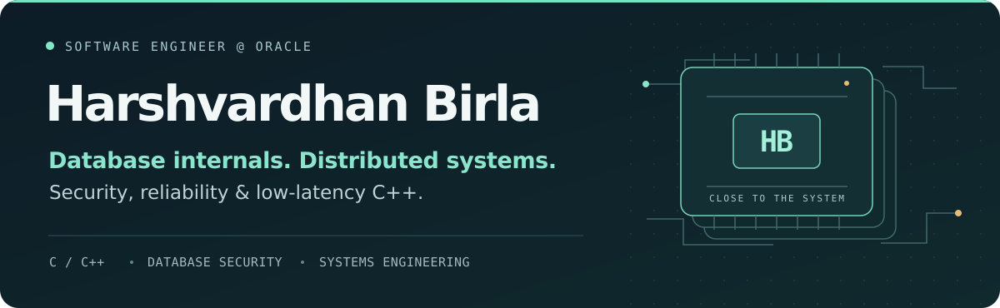
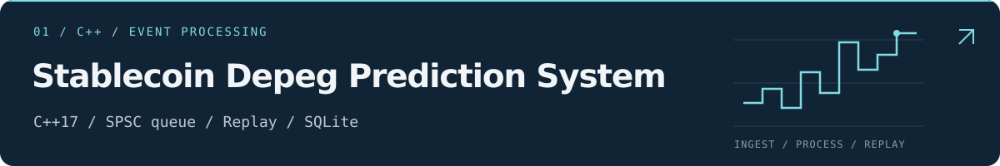
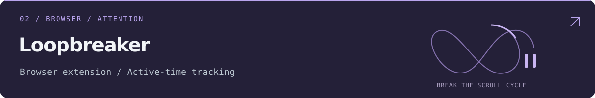
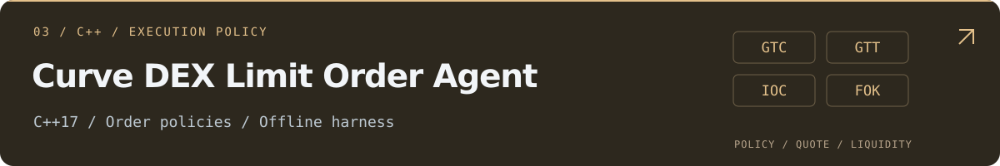

<a href="https://harshvardhanb11.github.io">
  <picture>
    <source media="(max-width: 600px)" srcset="header-mobile.svg">
    
  </picture>
</a>

  
  &nbsp;&nbsp;
  

## 👨‍💻 About me

I’m **Harshvardhan**, a Software Engineer at **Oracle**. I enjoy working on the parts of software where correctness, reliability, and performance meet.

- 🛡️ **At Oracle:** database security and C-based RDBMS internals, including Oracle Label Security and access-control components.
- 🔎 **In the debugger:** production crashes, memory-safety issues, security-critical defects, and integration across database releases.
- ⚙️ **Outside work:** distributed storage and compute systems, event-driven infrastructure, and low-latency C++ backends.
- 🎓 **Background:** B.E. (Hons.), Computer Science · BITS Pilani, Goa Campus · 2025.

**Currently interested in:** database internals, distributed systems, storage, concurrency, security, and performance engineering.

## 🚀 Selected projects

<a href="https://github.com/harshvardhanb11/stablecoin_depeg_prediction_system">
  <picture>
    <source media="(max-width: 600px)" srcset="event-engine-mobile.svg">
    
  </picture>
</a>

A **C++17 event-processing backend** with a lock-free SPSC queue, live and replayable inputs, explainable alerts, circuit-breaker handling, and SQLite persistence.

**Measured locally:** 8.37M queue events/s · 10.9 μs p99 decision latency. These are repository-reported results from separate local benchmarks; network latency is excluded.

[Explore the implementation →](https://github.com/harshvardhanb11/stablecoin_depeg_prediction_system)

---

<a href="https://github.com/harshvardhanb11/Loopbreaker">
  <picture>
    <source media="(max-width: 600px)" srcset="loopbreaker-mobile.svg">
    
  </picture>
</a>

A browser extension that makes **short-form video habits visible** and introduces intentional pauses. It tracks active watch time, recognizes repeat videos across changing interfaces, and excludes background-tab time.

[Explore Loopbreaker →](https://github.com/harshvardhanb11/Loopbreaker)

---

<a href="https://github.com/harshvardhanb11/curve_dex_limit-order-agent">
  <picture>
    <source media="(max-width: 600px)" srcset="curve-agent-mobile.svg">
    
  </picture>
</a>

A **C++17 order-policy engine** for GTC, GTT, IOC, and FOK behavior, with quote and liquidity checks and a deterministic offline harness. Transaction submission is mocked.

[Explore the execution logic →](https://github.com/harshvardhanb11/curve_dex_limit-order-agent)

## 🛠️ Tools I work with

| Area | Languages & tools |
| :--- | :--- |
| Systems & debugging | C, C++, Linux, GDB, CMake |
| Data & infrastructure | Oracle RDBMS, PostgreSQL, SQLite, Kafka, ZooKeeper, Redis, HDFS |
| Application development | Python, Java, SQL, PL/SQL, Gradle |
| Development workflow | Git, Docker, shell scripting |

<b>A couple more things I’ve built</b>

- [Interview Sentiment Analysis](https://github.com/harshvardhanb11/sentiment-analysis) — a RoBERTa-based notebook workflow for interview-text sentiment experiments.
- [Distributed TensorFlow on SageMaker](https://github.com/harshvardhanb11/aws-tensorflow) — a TensorFlow 2 and SageMaker distributed-training walkthrough using MNIST.

## 🤝 Let’s connect

Interested in **databases, distributed systems, backend infrastructure, or performance engineering**? I’d enjoy comparing notes.

**[Personal website ↗](https://harshvardhanb11.github.io)** &nbsp;·&nbsp; **[harshvardhanb11@gmail.com](mailto:harshvardhanb11@gmail.com)**
